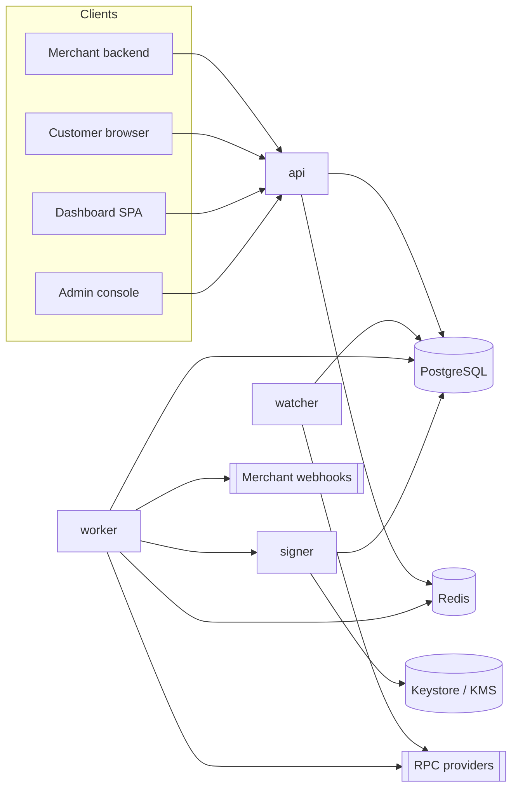
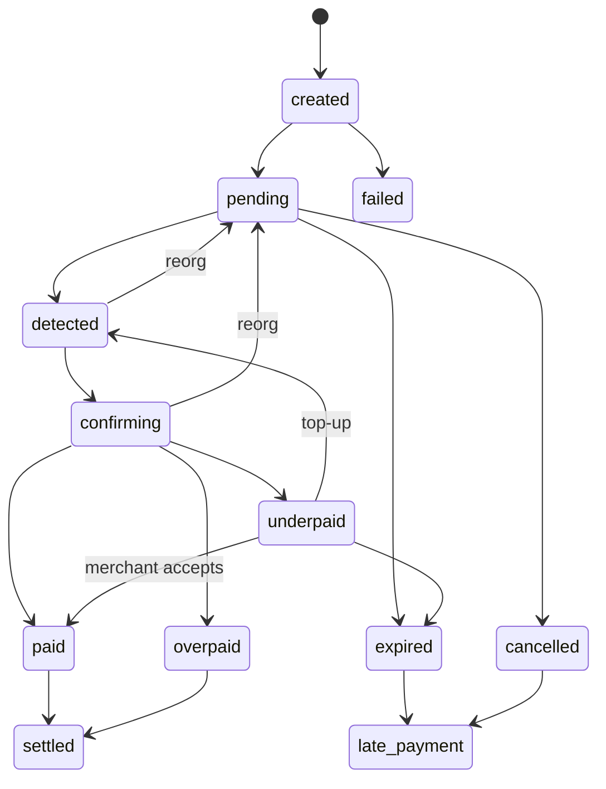

# Architecture

Modular monolith, four processes, one Postgres, one Redis.

| Process | Image | Exposure | Holds keys |
|---|---|---|---|
| api | `apps/server` | public (behind TLS proxy) | no (xpubs only) |
| worker | `apps/server` | none | no |
| watcher | `apps/server` | none | no |
| signer | `apps/signer` | mTLS from worker only | yes (custodial only, M7) |



## Layout

```
packages/core     pure domain: money, errors, state machine, fee math, interfaces, zod schemas. No IO.
apps/server       api / worker / watcher entrypoints, modules, migrations, tests
apps/signer       isolated signing service (M7b, D-088): own process, own DB role, intents only
apps/dashboard    merchant dashboard, Vite + React SPA (M3b)
apps/admin        admin console, Vite + React SPA, separate origin + auth domain (M5b)
docs/             this folder
```

## Milestones

MVP (in order): M0 → M1 → M2 → M3 → M3b → M4 → M5 → M5b → M6 → M8. Pause after M8 for owner review.

| # | Scope |
|---|---|
| M0 | Scaffold, CI, config validation, logger, error model, docs |
| M1 | DB schema + migrations, merchants, auth, API keys, RBAC, 2FA, audit log, rate limiting |
| M2 | Chain/token registry, EVM adapter, HD + xpub derivation, custody strategy layer, address allocation |
| M3 | Invoices, state machine, idempotency, expiry, hosted checkout, payment links |
| M3b | Minimal merchant dashboard: login, 2FA, API keys, invoices, webhooks, xpub, test/live toggle |
| M4 | Watcher: scanner, cursors, reorg handling, confirmations, matching, leader election |
| M5 | Ledger, fees, balances, outbox, reconciliation |
| M5b | Minimal admin console: merchants, kill switches, audit log, risk flags, manual resolve underpaid/late |
| M6 | Webhooks: signing, retries, SSRF guard, replay, secret rotation |
| M8 | Non-custodial xpub mode: xpub management, fee models, derivation visibility |
| M7 | Custodial settlement (after review; feature flag, off in production) |
| M9 | Platform/sub-merchant mode, admin API completion, risk hooks, metrics, alerts |
| M10 | Full dashboard, reports/exports, emails, widget, SDKs, WooCommerce plugin |
| M11 | Hardening: security, chaos, load tests, HA doc, runbook, launch checklist |
| M12 | Forwarder custody mode (stretch, experimental) |

## Rules

- Core depends on interfaces only (`ChainAdapter`, `AddressDeriver`, `Signer`, `CustodyStrategy`). Chains and tokens are registry rows, not code.
- Money is `bigint` minor units in code and `NUMERIC(78,0)` in the DB. Decimal strings exist only at the API edge (`toMinorUnits` / `fromMinorUnits`).
- Payment confirmation is one DB transaction: invoice + payment + ledger + outbox event.
- Errors: every non-2xx response is `{ error: { code, message, details?, request_id } }`. Codes live in `packages/core/src/errors.ts`.
- Every response carries `x-request-id`. A caller-supplied id is honored only if it matches `[A-Za-z0-9._-]{8,128}`.

## Invoice state machine



`settled` means: custodial, sweep confirmed and merchant balance moved from pending to available; non-custodial, platform fee charged.
