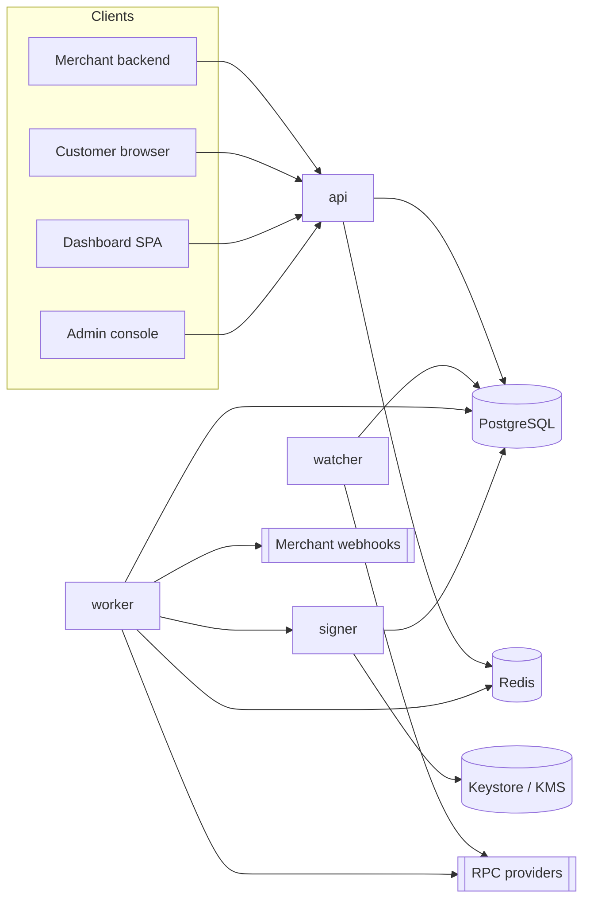
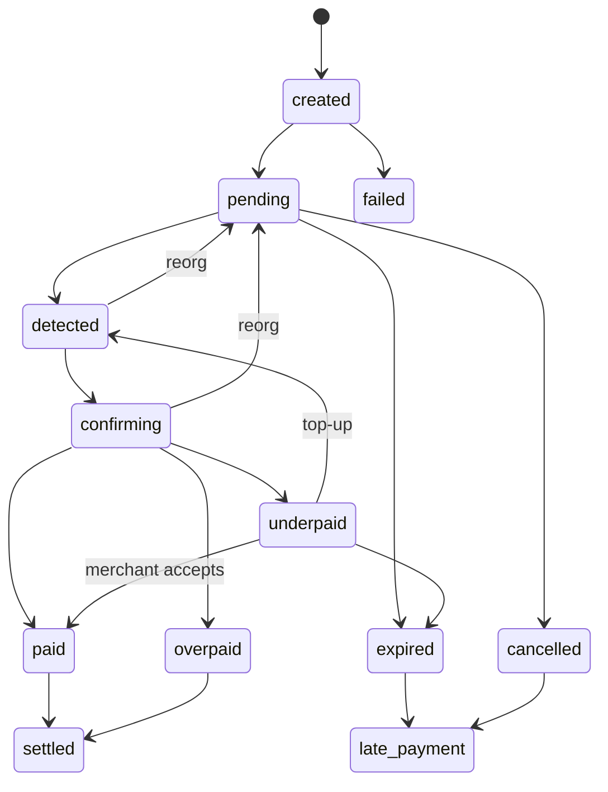

# Architecture

Modular monolith, four processes, one Postgres, one Redis.

| Process | Image | Exposure | Holds keys |
|---|---|---|---|
| api | `apps/server` | public (behind TLS proxy) | no (xpubs only) |
| worker | `apps/server` | none | no |
| watcher | `apps/server` | none | no |
| signer | `apps/signer` | mTLS from worker only | yes (custodial only, M7) |



## Layout

```
packages/core     pure domain: money, errors, state machine, fee math, interfaces, zod schemas. No IO.
apps/server       api / worker / watcher entrypoints, modules, migrations, tests
apps/signer       isolated signing service (M7)
apps/dashboard    Vite + React SPA (M10)
docs/             this folder
```

## Rules

- Core depends on interfaces only (`ChainAdapter`, `AddressDeriver`, `Signer`, `CustodyStrategy`). Chains and tokens are registry rows, not code.
- Money is `bigint` minor units in code and `NUMERIC(78,0)` in the DB. Decimal strings exist only at the API edge (`toMinorUnits` / `fromMinorUnits`).
- Payment confirmation is one DB transaction: invoice + payment + ledger + outbox event.
- Errors: every non-2xx response is `{ error: { code, message, details?, request_id } }`. Codes live in `packages/core/src/errors.ts`.
- Every response carries `x-request-id`. A caller-supplied id is honored only if it matches `[A-Za-z0-9._-]{8,128}`.

## Invoice state machine



`settled` means: custodial, sweep confirmed and merchant balance moved from pending to available; non-custodial, platform fee charged.
