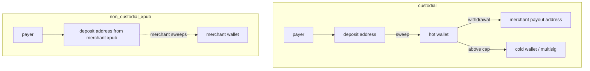

# Custody modes

Set per merchant (`custody_mode`). Same watcher, invoices and webhooks for all modes; behavior differs only in the
`CustodyStrategy` implementation. Immutable after the first live invoice except through an audited admin migration.

| | custodial | non_custodial_xpub | non_custodial_forwarder |
|---|---|---|---|
| Status | M7, behind feature flag, off in production | M8, MVP | M12, experimental, audit required |
| Deposit address | Platform HD wallet, `m/44'/60'/{account}'/0/{i}` | Merchant account xpub (depth 3), child `0/{i}` | CREATE2 forwarder |
| Keys on app servers | xpub only | xpub only | none |
| Who moves funds | Platform (sweep, withdrawal via signer) | Merchant, with their own wallet | Contract auto-forwards |
| Merchant balance | Yes (ledger) | No | No |
| Fee collection | Deducted at credit | Prepaid fee balance or periodic fee invoice | On-chain split |

## Fund flows

## Guarantees for non_custodial_xpub

1. Build: the strategy module cannot import signer, settlement or withdrawal code (dependency rule in CI).
2. Database: inserts into `settlement_sweeps` / `withdrawals` are rejected by trigger for non-custodial merchants.
3. Tests: end-to-end flow asserts zero signer calls and zero sweep/withdrawal jobs.

## Merchant responsibilities (non-custodial)

Keep their seed safe; supply an account-level xpub (not an xprv or seed, which are refused); scan their wallet to the
derivation index shown in the dashboard (invoices that expire unpaid create gaps beyond the usual 20-address limit);
keep the prepaid fee balance above zero, or new invoices are blocked.

Full fee-model and key-exposure details are written in M8 (non-custodial) and M7 (custodial).
