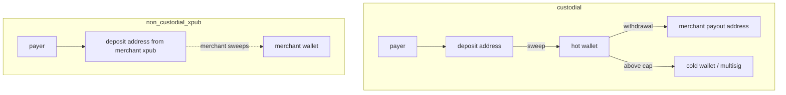

# Custody modes

Set per merchant (`custody_mode`). Same watcher, invoices and webhooks for all modes; behavior differs only in the
`CustodyStrategy` implementation. Immutable after the first live invoice (DB trigger `merchant_custody_guard`) except
through an audited admin migration (later milestone). Each invoice snapshots `custody_mode`.

| | custodial | non_custodial_xpub | non_custodial_forwarder |
|---|---|---|---|
| Status | M7, behind feature flag, off in production | M8, MVP | M12, experimental, audit required |
| Deposit address | Platform HD wallet, `m/44'/60'/{account}'/0/{i}` | Merchant account xpub (depth 3), child `0/{i}` | CREATE2 forwarder |
| Keys on app servers | xpub only | xpub only | none |
| Who moves funds | Platform (sweep, withdrawal via signer) | Merchant, with their own wallet | Contract auto-forwards |
| Merchant balance | Yes (ledger) | No | No |
| Fee collection | Deducted at credit | Prepaid fee balance or periodic fee invoice | On-chain split |

## Fund flows

## Address allocation (M2)

`allocateDepositAddress` (in `apps/server/src/modules/custody/custody.ts`) runs inside the invoice-creation transaction:

1. Reads the merchant's custody mode; suspended merchants are refused.
2. `strategyFor(mode)`: `non_custodial_xpub` → merchant xpub; `custodial` → platform wallet (only with `FEATURE_CUSTODIAL`);
   forwarder → refused until M12.
3. `UPDATE … SET next_index = next_index + 1 … RETURNING` on the key's row: the row lock serializes concurrent invoices,
   so each gets a distinct index. A rolled-back invoice rolls back its index too (no address was ever shown).
4. Public derivation of `<account xpub>/0/<index>`, insert into `deposit_addresses`.

Database guards that hold even if application code is wrong:

| Guard | Effect |
|---|---|
| unique (family, address), unique (source key, index) | an address / index serves exactly one invoice, across all EVM chains |
| composite FK (xpub, merchant, mode, family) | a merchant can only receive on addresses from its own xpub |
| `deposit_address_guard` trigger | source must match custody mode; chain enabled, same family, testnet ⇔ test mode |
| `xpub_row_guard` trigger | counters never move backwards; xpub identity never changes in place |
| `key_fingerprint_unique` trigger + unique indexes | one key, one owner: across merchants and the platform wallet, in any encoding |
| no DELETE/TRUNCATE + immutability trigger | address ↔ derivation mapping is permanent |

## Guarantees for non_custodial_xpub

1. Build: the strategy module cannot import signer, settlement or withdrawal code (dependency rule in CI).
2. Database: inserts into `settlement_sweeps` / `withdrawals` are rejected by trigger for non-custodial merchants.
3. Tests: end-to-end flow asserts zero signer calls and zero sweep/withdrawal jobs.

## Merchant responsibilities (non-custodial)

Keep their seed safe; supply an account-level xpub (not an xprv or seed, which are refused); scan their wallet to the
derivation index shown in the dashboard (invoices that expire unpaid create gaps beyond the usual 20-address limit);
keep the prepaid fee balance above zero, or new live invoices are blocked (enforced from M8, with fee top-ups).

Full fee-model and key-exposure details are written in M8 (non-custodial) and M7 (custodial).
