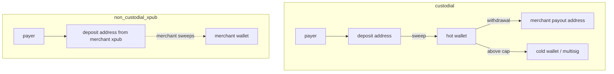

# Custody modes

Set per merchant (`custody_mode`). Same watcher, invoices and webhooks for all modes; behavior differs only in the
`CustodyStrategy` implementation. Immutable after the first live invoice (DB trigger `merchant_custody_guard`) except
through an audited admin migration (later milestone). Each invoice snapshots `custody_mode`.

| | custodial | non_custodial_xpub | non_custodial_forwarder |
|---|---|---|---|
| Status | M7 built, behind `FEATURE_CUSTODIAL` (off by default); production takes the seed KEK from a secret-manager file, no KMS (D-010) | M8, MVP | M12 built (D-097), behind `FEATURE_FORWARDER`; contract audit required before mainnet |
| Deposit address | Platform HD wallet, `m/44'/60'/{account}'/0/{i}` | Merchant account xpub (depth 3), child `0/{i}` | CREATE2 forwarder |
| Keys on app servers | xpub only | xpub only | none |
| Who moves funds | Platform (sweep, withdrawal via signer) | Merchant, with their own wallet | Contract auto-forwards |
| Merchant balance | Yes (ledger) | No | No |
| Fee collection | Deducted at credit | Prepaid fee balance or periodic fee invoice | On-chain split |

## Fund flows

## Address allocation (M2)

`allocateDepositAddress` (in `apps/server/src/modules/custody/custody.ts`) runs inside the invoice-creation transaction:

1. Reads the merchant's custody mode; suspended merchants are refused.
2. `strategyFor(mode)`: `non_custodial_xpub` → merchant xpub; `custodial` → platform wallet (only with `FEATURE_CUSTODIAL`);
   `non_custodial_forwarder` → CREATE2 forwarder address (only with `FEATURE_FORWARDER`, see "Forwarder mode").
3. `UPDATE … SET next_index = next_index + 1 … RETURNING` on the key's row: the row lock serializes concurrent invoices,
   so each gets a distinct index. A rolled-back invoice rolls back its index too (no address was ever shown).
4. Public derivation of `<account xpub>/0/<index>`, insert into `deposit_addresses`.

Database guards that hold even if application code is wrong:

| Guard | Effect |
|---|---|
| unique (family, address), unique (source key, index) | an address / index serves exactly one invoice, across all EVM chains |
| composite FK (xpub, merchant, mode, family) | a merchant can only receive on addresses from its own xpub |
| `deposit_address_guard` trigger | source must match custody mode; chain enabled, same family, testnet ⇔ test mode |
| `xpub_row_guard` trigger | counters never move backwards; xpub identity never changes in place |
| `key_fingerprint_unique` trigger + unique indexes | one key, one owner: across merchants and the platform wallet, in any encoding |
| no DELETE/TRUNCATE + immutability trigger | address ↔ derivation mapping is permanent |

## Guarantees for non_custodial_xpub

1. Build: the strategy module cannot import signer, settlement or withdrawal code (dependency rule in CI).
2. Database: inserts into `settlement_sweeps` / `withdrawals` are rejected by trigger for non-custodial merchants.
3. Tests: end-to-end flow asserts zero signer calls and zero sweep/withdrawal jobs.

## Custodial ledger (M7a, D-087)

| Event | Journal | Lines |
|---|---|---|
| Payment confirmed (A) | `payment` | Dr `custody_deposits` A (platform) / Cr `merchant_pending` A |
| Invoice settled after its deposit address was swept (R received, F fee) | `settlement` | Dr `merchant_pending` R / Cr `merchant_available` R−F / Cr `platform_fee_revenue` F |
| Underpaid invoice closed as `partially_paid` after its deadline, swept (R received, F fee) | `settlement` | same lines |

- Fee = floor(min(R, expected) × bps / 10000) + fixed, never above that base; deducted at settlement. Custodial merchants
  have no prepaid fee balance (`fee_status` = `not_enforced`, live invoices never get 402).
- Underpaid (D-099): the invoice stays open until its deadline, so the customer can send the rest. After it, once the
  chain's scanner has passed the deadline and every confirmed payment was swept, the custody worker closes it as
  `partially_paid` and credits what arrived: fee = floor(R × bps / 10000) + fixed, never above R. Final: nothing
  reopens it. Before the deadline an admin may still accept it as paid.
- Late payments (after expiry or cancellation) stay in `merchant_pending` until an admin accepts them (admin console,
  TOTP); they then settle like any paid invoice. Not accepted = they stay pending (refund: RUNBOOK). Money arriving
  after an invoice closed (`settled`, `partially_paid`) also stays pending; reconciliation reports it
  (`custodial_settlement`) so an operator decides.
- The database lets each journal kind touch only its own account kinds (`ledger_entry_guard`): a custodial payment can
  never book into `merchant_received`, a `fee` journal is refused on a custodial invoice, a `settlement` journal on
  anything but a paid, overpaid or partially paid custodial invoice. Only a custodial invoice can become `partially_paid`.
- Reconciliation adds `custodial_received`, `custodial_settlement` and `negative_merchant_balance`.

## Sweeps (M7c, D-089)
Worker queue `custody` (every 15 s, only with `FEATURE_CUSTODIAL`):
1. **Plan**: one sweep per custodial deposit address holding confirmed payments not swept yet; amount = confirmed
   payments − earlier confirmed sweeps; destination = the active hot wallet (DB trigger enforces both).
2. **Gas**: the signer tops the address up from the gas wallet (enough for one token transfer at today's price +20%,
   capped by `SIGNER_MAX_GAS_TOPUP`), or answers `not_needed`.
3. **Sweep**: the signer signs `transfer(hot, amount)` from the deposit address; the worker broadcasts it.
4. **Confirm**: after `max(chain default, token minimum)` confirmations: sweep `confirmed`, journal
   Dr `custody_hot` / Cr `custody_deposits`, and the invoice settles if it is paid (`settleIfSwept`).
Unmined transactions are rebroadcast with the same bytes; only a mined revert fails a sweep. Reconciliation:
`sweep_journal`, `negative_custody`. Metrics: `gw_sweeps_open`, `gw_sweep_oldest_open_seconds`, `gw_sweeps_failed_24h`.

## Custody on / off (D-098)
The merchant decides, not an admin: dashboard > Payout wallet > "Custody on" (owner + 2FA), offered only while the
platform has `FEATURE_CUSTODIAL` on. Turning custody off is refused while the platform holds funds for the merchant
(pending, available or withdrawing, any mode) or custody invoices are still open: withdraw everything first. Like every
mode change: new invoices only, locked after the first live invoice, audited. With custody on the dashboard also shows
Withdrawals.

## Payouts to users and withdrawal limits (D-100)
- **Payouts to users.** A merchant with custody on pays its own users from its balance: `POST /v1/payouts` (key scope
  `payouts:write`) with the user's id (`customer_ref`) and wallet. Any EIP-55-valid wallet, but never a platform wallet,
  a deposit address of any merchant or a blocked address (`payout_destination_allowed`, used by the app, the database
  guard and the signer). Auto-approved: sent at the next custody worker run.
- **Payout fee.** A flat fee per user payout (`merchants.payout_fee`, token units, set by an admin), held with the
  amount and booked to `platform_fee_revenue` when the payout confirms (`withdrawal` journal: merchant_withdrawing
  +(amount+fee), custody_hot −amount, platform_fee_revenue −fee); released with the amount on failure.
- **Limits.** The merchant sets, per mode and token, a one-time limit and a daily limit (any 24 hours) in the
  dashboard (owner + 2FA, applies at once). They cap all its withdrawals: its own and its user payouts. Live user
  payouts need both. Checked at request, by the database guard and again by the signer (a lowered limit stops a
  queued payout: it fails with `merchant_limit` and the hold is released).

## Withdrawals (M7d, D-090)
Only while custody is on (`FEATURE_CUSTODIAL`): with it off, requests and approvals are refused (`custody_off`) and the
dashboard says withdrawals are paused; balances stay, and cancelling or rejecting still releases a hold.
1. **Payout address** (dashboard, owner + TOTP): EIP-55 checksum checked; live addresses become current 24 h after
   they are added (owners emailed; cancellable meanwhile); test addresses at once. Withdrawals always go to the
   current one; a newer address or a cancellation stops older requests (the signer re-checks).
2. **Request** (dashboard: owner/finance + TOTP; API: `withdrawals:write`): at most the available balance, held at
   once (`withdrawal_hold`). Refused while suspended or `payouts_frozen`. Test mode: approved at once.
3. **Approval** (admin console, `withdrawals:approve` + TOTP): live needs one admin; at or above
   `WITHDRAWAL_TWO_PERSON_MIN` (token units) two different admins. Rejecting (or the merchant cancelling) releases.
4. **Sending** (custody worker): the signer re-checks status and approvals, merchant state and flags, current payout
   address, the hold, its own per-token limits (per transaction, per 24 h) and the hot wallet's token and gas, then
   signs a token transfer from the hot wallet. Confirmed: `withdrawal` journal (leaves custody). Reverted or refused
   as wrong: `withdrawal_release` (back to available). Refused for the moment (paused, limits, hot wallet short):
   waits with backoff; admins see `last_error`.
5. Webhook events `withdrawal.<status>`; owners are emailed on request and on the outcome.

## Forwarder mode (M12, D-097)
For merchants who have a wallet address but no xpub (MetaMask, Trust, exchange-style wallets).
- **Setup.** Dashboard > Payout wallet: mode "Wallet address" (owner + 2FA), then a payout address (D-090 rules: test
  at once, live after 24 h). The mode locks after the first live invoice.
- **Address.** Each invoice gets `CREATE2(factory, salt, Forwarder(merchant, feeWallet, token, feeBps, feeCap))`, salt =
  keccak of the deposit address row id. Nothing is deployed until the first flush. `forwarder_params` stores the
  committed values (immutable; DB-tied to the current payout address, the active `fee` platform wallet, the factory of
  the chain and the token).
- **Fee.** `floor(amount * feeBps / 10000)` per flush, total capped at the fee on the invoice amount (an overpayment is
  never charged; same base as `feeBase`). No fixed fee and no prepaid fee balance in this mode. Other tokens and the
  native coin are forwarded 100% to the merchant.
- **Flush.** Worker (`forwards` queue): once payments are confirmed it reads the on-chain balance and creates a forward;
  the signer's gas wallet calls `ForwarderFactory.deployAndFlush` (the signer re-derives the address and checks the
  factory code first); after confirmations the `Flushed` event gives what moved: `forward_fee` journal
  (`merchant_received` -fee / `merchant_sales` +fee, `platform_fee_wallet` +fee / `platform_fee_revenue` -fee), and the
  invoice settles once forwards cover what it received.
- **Anyone can flush.** Factory and forwarders are permissionless: a merchant can always move late payments out
  themselves (the planner then leaves that address alone; such flushes are not booked).

## Merchant responsibilities (non-custodial)

Keep their seed safe; supply an account-level xpub (not an xprv or seed, which are refused); set their wallet's address
gap limit to the value the dashboard shows (invoices that expire unpaid create gaps beyond the usual 20-address limit);
sign the ownership challenge with the wallet's first account when registering a live xpub;
keep the prepaid fee balance (per token) above zero, or new live invoices are refused with 402 (D-076).

Fee model and prepaid balance: D-076. Custodial key exposure: M7.
